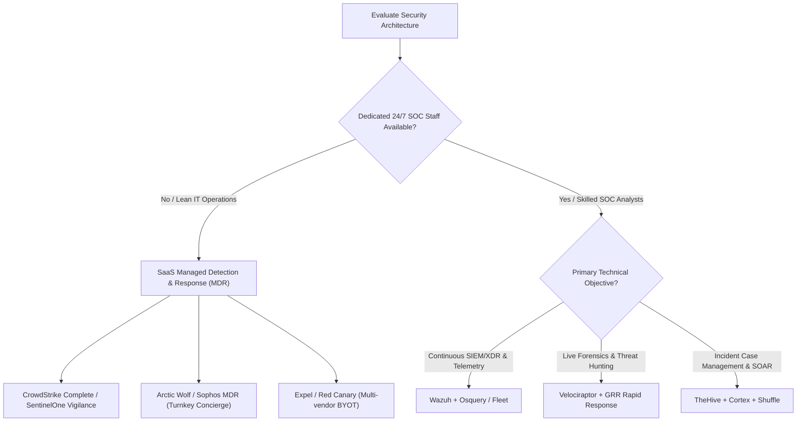

# 🛡️ Awesome Managed Detection & Response (MDR)

  

  
  
  
  
  

> 🚀 A curated list of leading **Managed Detection and Response (MDR)**, **24/7 Managed SOC services**, **Managed XDR/EDR ecosystems**, and battle-tested **open-source security operations tooling** for real-time telemetry analysis, proactive threat hunting, and rapid incident containment.

---

## 📑 Table of Contents

- [📊 Sector Overview & Market Dynamics](#-sector-overview--market-dynamics)
- [🏢 SaaS & Hosted Managed Detection & Response (MDR) Platforms](#-saas--hosted-managed-detection--response-mdr-platforms)
- [💻 Open-Source SOC, SIEM, SOAR & Detection Engineering Tooling](#-open-source-soc-siem-soar--detection-engineering-tooling)
- [📐 Evaluation Criteria & Architectural Trade-offs](#-evaluation-criteria--architectural-trade-offs)
- [🤝 How to Contribute](#-how-to-contribute)
- [💖 Support & Community](#-support--community)
- [⭐ Star History](#-star-history)
- [⚠️ Disclaimer](#️-disclaimer)

---

## 📊 Sector Overview & Market Dynamics

The global **Managed Detection and Response (MDR)** market is estimated at **$5.4B–$6.5B in 2025–2026** and is accelerating at an estimated **20–22% CAGR** driven by persistent cybersecurity talent shortages, complex hybrid-cloud surfaces, and aggressive ransomware activity. The industry features **moderate concentration at the foundational endpoint/XDR telemetry layer** (led by titans like CrowdStrike and SentinelOne), but remains **highly fragmented across managed security service delivery**, where specialized MDR providers, boutique SOC operations, and MSSPs compete on analyst depth, multi-vendor telemetry ingestion (BYOT), and tailored incident response SLAs.

---

## 🏢 SaaS & Hosted Managed Detection & Response (MDR) Platforms

Managed Detection & Response provides round-the-clock monitoring, behavioral detection engineering, proactive threat hunting, and rapid incident remediation without necessitating an internal 24/7 Security Operations Center.

The table below benchmarks the premier SaaS and hosted platforms, sorted by **Company Size (Revenue / Market Cap / Enterprise Valuation) in descending order**:

| Provider / Platform | Company Size (Valuation / Revenue) | Starting Pricing (Specific Baseline) | Free Tier Limits / Free Trial | Key Capabilities & Ideal Fit |
| :--- | :--- | :--- | :--- | :--- |
| **[CrowdStrike Falcon Complete](https://www.crowdstrike.com/)** | ~$250B+ Market Cap (~$4.8B FY26 Revenue) | ~$60–$100/endpoint/yr (Falcon Go/Pro baseline); Complete MDR adds turnkey 24/7 managed hunting & surgical remediation (annual minimums apply) | 15-day free trial (up to 25 endpoints with Falcon Prevent NGAV and Insight EDR; no credit card required) | The gold standard in managed endpoint detection; Falcon OverWatch threat hunters directly remediate intrusions on behalf of customer teams. |
| **[SentinelOne Vigilance / Singularity MDR](https://www.sentinelone.com/)** | ~$8.9B Market Cap (~$1.0B FY26 Revenue) | $69.99/endpoint/yr (Singularity Core); $179.99/endpoint/yr (Singularity Complete); Vigilance Managed Hunt/Respond available as scoped add-on | 14-day to 30-day enterprise Proof of Concept (POC) with up to 14 days telemetry retention (partner/sales provisioned, no perpetual free tier) | Autonomous client-side behavioral AI detection with patented 1-Click Rollback for ransomware recovery, reinforced by 24/7 Vigilance SOC analysts. |
| **[Arctic Wolf MDR](https://arcticwolf.com/)** | $4.3B Private Valuation (~$400M+ ARR) | Mid-five-figure entry (~$25,000–$35,000/yr baseline deployment based on user/sensor scale) | Guided interactive live sandbox & custom 30-day scoped SOC pilot (no perpetual free tier) | Turnkey Concierge Security Team model delivering continuous 24/7 monitoring, strategic posture guidance, and full-spectrum response across endpoint, network, and cloud. |
| **[Sophos MDR](https://www.sophos.com/)** | ~$3.9B Enterprise Valuation (~$1.2B Revenue) | ~$35–$50/endpoint/yr (Sophos Intercept X baseline); Sophos MDR Complete typically ~$65–$95/endpoint/yr | 30-day full-featured free trial (unlimited endpoint testing during trial period, self-service sign-up) | 24/7 threat hunting and automated response natively coupled with Sophos Intercept X; includes specialized Identity Threat Detection and Response (ITDR) extensions. |
| **[Rapid7 MDR](https://www.rapid7.com/)** | ~$2.2B Market Cap (~$820M FY25 Revenue) | ~$17–$24/asset/yr for foundational InsightIDR; Full MDR tiers scale from ~$25,000/yr minimum commitment | 30-day free trial (InsightIDR cloud SIEM trial with unlimited event log ingestion during the 30-day window) | Deep integration between Rapid7 InsightIDR and in-house SOC analysts, delivering unified user behavioral analytics (UBA) and cross-telemetry threat containment. |
| **[Red Canary MDR](https://redcanary.com/)** | ~$1.0B Valuation (~$150M+ ARR) | Scoped on active endpoints/identities; starting baseline contracts typically range from ~$20,000–$30,000/yr | 30-day scoped MDR pilot on live corporate endpoints with real-time detection engineering tests | Pioneer of managed detection engineering with customer-validated 99% alert accuracy, automated playbook execution, and sub-30-minute investigation workflows. |
| **[Expel MDR](https://expel.com/)** | ~$1.0B Valuation (~$120M+ ARR) | Platform subscriptions typically start around ~$25,000–$40,000/yr base tiered by ingested signal volume | Scoped interactive guided sandbox demo & 30-day enterprise evaluation (no perpetual free tier) | Multi-vendor "Bring Your Own Tool" (BYOT) MDR powered by Ruxie AI, triaging alerts across SIEM, cloud workloads, SaaS, and endpoints in under 30 seconds. |
| **[Mandiant Managed Defense](https://www.mandiant.com/)** | Acquired by Google ($5.4B transaction) | Scoped enterprise annual service tier starting at ~$50,000+/yr minimum commitment | Custom engagement scoping through Google Cloud Security & Mandiant IR teams (no public free trial) | Elite frontline nation-state threat intelligence combined with battle-hardened incident response operators monitoring and hunting across enterprise environments. |
| **[eSentire MDR](https://www.esentire.com/)** | ~$450M Valuation (~$100M ARR) | Core MDR deployments baseline around ~$25,000–$35,000/yr based on endpoint count and telemetry ingestion volume | 30-day scoped SOC proof-of-value engagement with live threat hunting (no perpetual free tier) | Multi-signal MDR covering endpoints, network, logs, identity, and cloud workloads with an industry-recognized Mean Time to Contain (MTTC) under 15 minutes. |
| **[Secureworks Taegis MDR](https://www.secureworks.com/)** | ~$855M Acquisition Valuation (~$360M Revenue) | Taegis XDR starting ~$40–$55/endpoint/yr; Managed Taegis MDR typically starts at ~$20,000/yr minimum platform base | 30-day guided interactive trial of Taegis XDR platform (up to 50 assets evaluated, sales-assisted) | Cloud-native Taegis XDR ecosystem combining automated detector algorithms with 24/7 Secureworks Counter Threat Unit (CTU) hunting specialists. |

---

## 💻 Open-Source SOC, SIEM, SOAR & Detection Engineering Tooling

While **Managed Detection & Response (MDR)** is inherently an operator-driven human service, the underlying detection engines, telemetry collectors, and case orchestration frameworks can be self-hosted.

The table below benchmarks prominent open-source SOC and detection tools, sorted by **GitHub Stars in descending order**:

| Repository / Tool | GitHub Stars | Core Architecture & Primary Role | Detection & Response Capabilities |
| :--- | :--- | :--- | :--- |
| **[Osquery](https://github.com/osquery/osquery)** |  | SQL-powered operating system instrumentation (C++) | Exposes an operating system as a high-performance relational database; allows analysts to execute scheduled or real-time SQL queries across OS processes, connections, and files. |
| **[Wazuh](https://github.com/wazuh/wazuh)** |  | Unified open-source SIEM & XDR platform (C/Python) | Production-ready host telemetry collector, log aggregation engine, File Integrity Monitoring (FIM), vulnerability detection, and active automated threat response scripts. |
| **[Sigma](https://github.com/SigmaHQ/sigma)** |  | Generic open detection format for log events (YAML) | Industry standard rule format enabling blue teams and MDR analysts to write log detection logic once and compile it into queries for Elasticsearch, Splunk, Wazuh, or QRadar. |
| **[Fleet](https://github.com/fleetdm/fleet)** |  | Osquery fleet management & endpoint observability (Go) | Enterprise osquery manager providing real-time telemetry streaming, CIS benchmark compliance audits, vulnerability scanning, and live endpoint querying. |
| **[MISP](https://github.com/MISP/MISP)** |  | Threat intelligence sharing & IOC platform (PHP/Python) | Open-source threat sharing platform for storing, correlating, and exchanging indicators of compromise (IOCs) and adversary tactics across international security communities. |
| **[GRR Rapid Response](https://github.com/google/grr)** |  | Remote live endpoint forensics & incident response (Python) | Google-developed incident response framework designed for deep, live memory analysis, remote file inspection, and timeline triage across large fleet infrastructures. |
| **[Security Onion](https://github.com/Security-Onion-Solutions/securityonion)** |  | Turnkey Linux distro for threat hunting & NSM (Linux/Docker) | Complete network security monitoring and enterprise log management platform bundling Zeek, Suricata, Stenographer, and an Elastic/OpenSearch backend for SOC analysts. |
| **[Velociraptor](https://github.com/velocidex/velociraptor)** |  | Endpoint forensics, live triage & VQL hunting (Go) | Rapid live endpoint interrogation engine powered by Velociraptor Query Language (VQL); gathers live memory dumps, MFT records, and forensic artifacts in minutes. |
| **[TheHive](https://github.com/TheHive-Project/TheHive)** |  | Collaborative Security Incident Response Platform (Scala) | Structured case management system tightly coupled with MISP and Cortex; enables analysts to track incident timelines, assign tasks, and enrich evidence observables. |
| **[Shuffle](https://github.com/Shuffle/Shuffle)** |  | Open-source Security Orchestration & Automation (Go/Python) | Visual no-code/low-code SOAR orchestrator with an extensive catalog of integrations to automate incident triage, enrichment, and isolation playbooks without custom scripts. |
| **[Cortex](https://github.com/TheHive-Project/Cortex)** |  | Observable analysis & active response engine (Scala/Python) | Microservices engine coordinating hundreds of analyzers and responders to dissect IP addresses, domains, URLs, hashes, and files in parallel during investigations. |
| **[XCLOAK Security Suite](https://github.com/The-Abhishek1/XCLOAK-SECURITY-SUITE)** |  | Integrated open-source enterprise SOC suite (Go) | Combines SIEM, SOAR, EDR telemetry agents, DPI, and UEBA behavioral baselining into an all-in-one deployable defense stack. |

---

## 📐 Evaluation Criteria & Architectural Trade-offs

When choosing between **Commercial Managed Detection and Response (MDR)** and **Self-Hosted Open-Source SOC Stacks**:

1. 💰 **Total Cost of Ownership (TCO):** Commercial MDR bundles infrastructure, platform licensing, and round-the-clock shift staffing into predictable operating expenditure. Self-hosted stacks eliminate software subscription fees but require substantial engineering investments for system maintenance, alert tuning, and 24/7 personnel coverage.
2. ⏱️ **Mean Time to Detect (MTTD) & Respond (MTTR):** Top-tier MDR services provide strict SLAs guaranteeing alert triage within minutes and incident containment within 15–30 minutes. Self-hosted deployments rely entirely on the availability and responsiveness of in-house personnel.
3. 🎯 **The Human Factor:** Tools collect telemetry and detect anomalies, but only skilled human operators can validate complex lateral movement, interpret business context, and execute surgical remediation without disrupting operations.

---

## 🤝 How to Contribute

1. 🍴 Fork the repository.
2. ✍️ Add or update entries in `README.md` following the established table structure.
3. 🔍 Ensure that pricing baselines, trial parameters, valuation metrics, and stargazer badges are verified.
4. 🚀 Submit a Pull Request with a descriptive summary of your additions.

---

## 💖 Support & Community

Thank you for exploring this curated guide! If you find this repository valuable for assessing MDR platforms and open-source SOC architectures, please consider supporting the project:

- ⭐ **Star** this repository to increase visibility for security analysts, blue teams, and engineering leaders.
- 🍴 **Fork** and contribute new entries, verified pricing updates, and detection tooling benchmarks.
- 📢 **Share** this resource across your security networks and professional blue team communities.
- ☕ **Sponsor**: Support ongoing research and maintenance via the [GitHub Sponsors Dashboard](https://github.com/sponsors/ishandutta2007).

---

##  Star History

---

## ⚠️ Disclaimer

- 📖 This repository is a community-curated knowledge base created strictly for educational, informational, and architectural evaluation purposes.
- ⚖️ Product pricing, licensing terms, corporate valuations, and market figures fluctuate based on negotiations, market conditions, and corporate changes. Always verify commercial terms directly with vendor sales representatives and certified partners.
